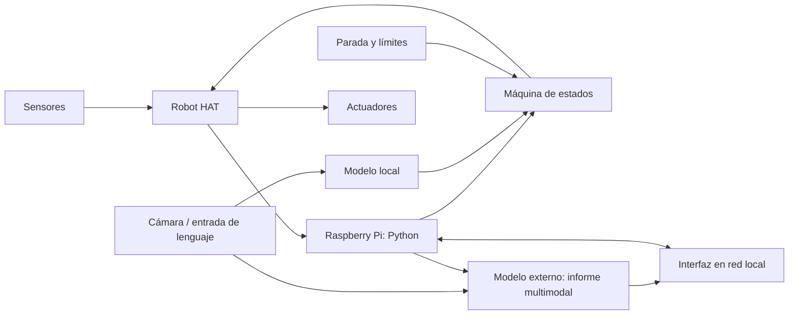

# Arquitectura y decisiones

**Entrega H1: 9 de noviembre de 2026.** Este es el documento de arquitectura y flujo del proyecto. Actualizarlo durante H2–H4 y registrar los cambios de diseño. Distinguir lo **comprobado en el robot real** de lo **previsto**. Diferenciar **datos**, **órdenes** y **alimentación**.

## Misión y criterio de éxito

- Plataforma y objetivo: `POR_COMPLETAR`.
- Entorno físico, punto de inicio y fin: `POR_COMPLETAR`.
- Entradas (sensores, cámara, operador) y salidas (movimiento, estado, interfaz): `POR_COMPLETAR`.
- Resultado observable que contará como éxito: `POR_COMPLETAR`.

## Bloques del sistema

Adaptar el diagrama al material confirmado de vuestro PiDog V2 o PiCar-X. Explicar qué función ejecuta la Raspberry Pi y cuál ejecuta la Robot HAT. Añadir alimentación y conexiones reales o pendientes.

## Flujo de operación

Describir y dibujar dos recorridos: **normal** (arranque → comprobaciones → percepción → decisión → acción → registro → fin/parada) y **de fallo** (por ejemplo, obstáculo, caída, lectura inválida, pérdida de red o parada manual). Indicar el estado seguro final y quién puede reanudar el robot. Para PiDog, explicar postura, marcha y estabilidad; para PiCar-X, tracción, dirección y recorrido. No atribuir al robot sensores aún no comprobados.

| Paso | Entrada y origen | Proceso o decisión | Salida y destino | Registro | Fallo y parada |
| --- | --- | --- | --- | --- | --- |
| Arranque | | | | | |
| Percepción | | | | | |
| Decisión | | | | | |
| Acción | | | | | |

## Interfaces

| Componente | Entrada | Salida | Error y respuesta segura |
| --- | --- | --- | --- |
| Adaptador de robot | | | |
| Máquina de estados | | | |
| IA local | | | |
| API externa multimodal | Imagen + consulta textual con medida | Informe, sin órdenes motoras | Timeout → decisión local intacta |
| IoT | | | |

## Seguridad, riesgos y plan de integración

- Límites de movimiento y condición de parada local: `POR_COMPLETAR`.
- Respuesta a obstáculo/caída, lectura inválida y pérdida de comunicación: `POR_COMPLETAR`.
- Riesgo prioritario 1 y alternativa: `POR_COMPLETAR`.
- Riesgo prioritario 2 y alternativa: `POR_COMPLETAR`.
- Qué se integrará y comprobará en H2, H3 y H4; responsable de cada tarea: `POR_COMPLETAR`.
- Dónde se hace la inferencia local, qué datos van a la API externa y cómo se evita que su respuesta mueva actuadores: `POR_COMPLETAR`.

## Decisiones fechadas

| Fecha | Decisión | Alternativas consideradas | Evidencia / motivo | Issue o PR |
| --- | --- | --- | --- | --- |
| | | | | |
