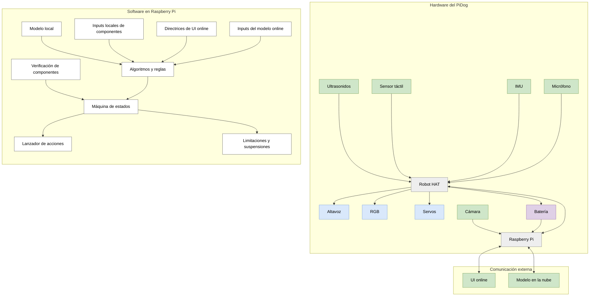
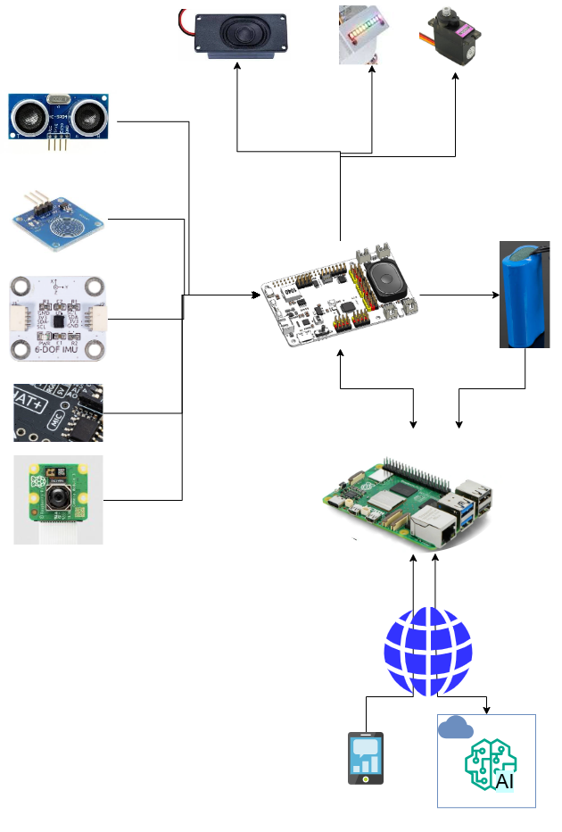
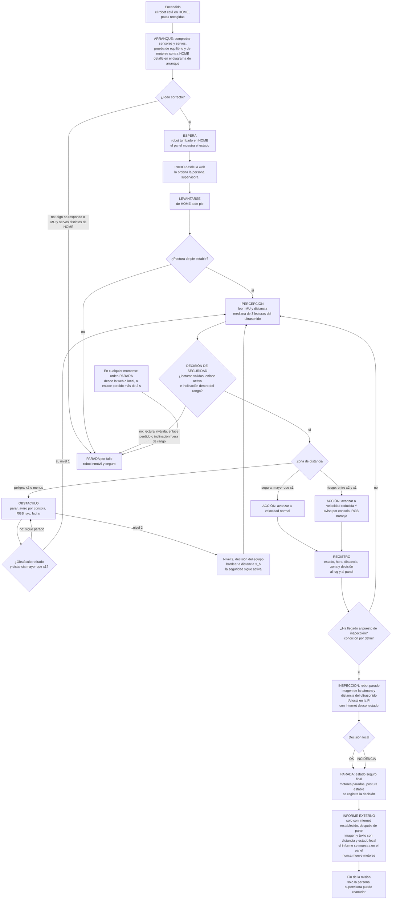
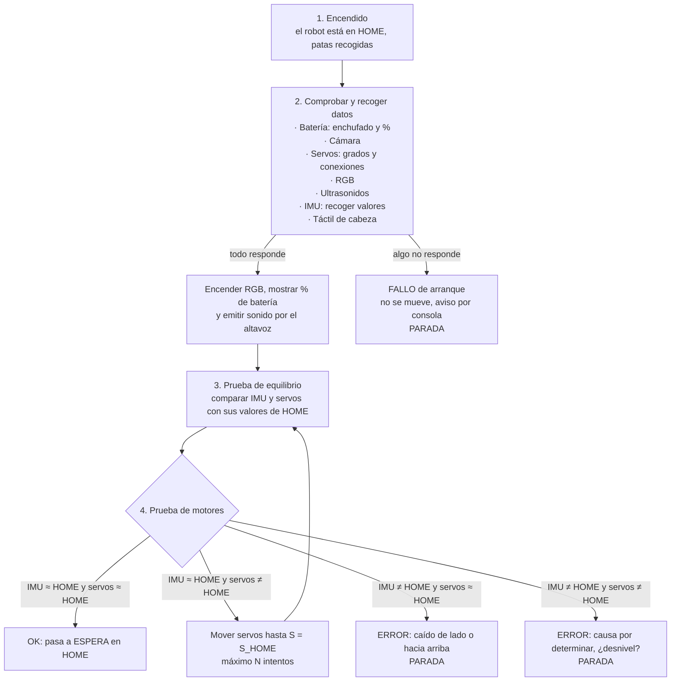
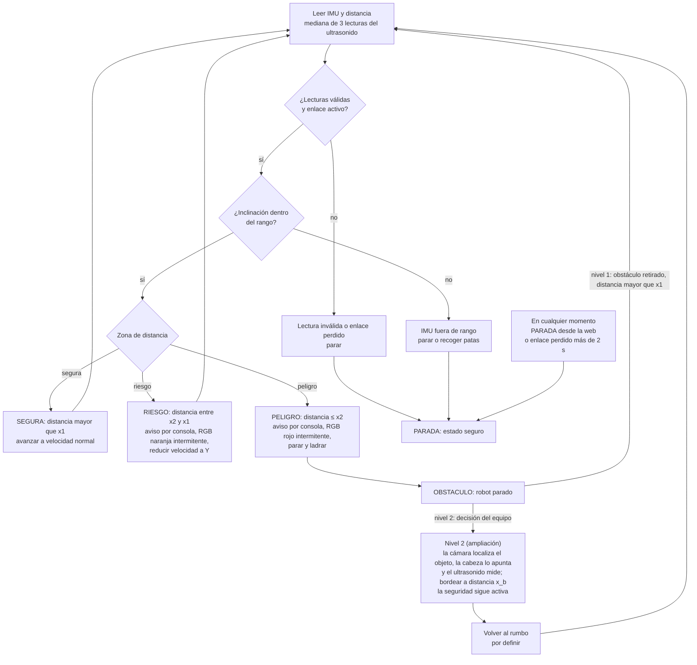
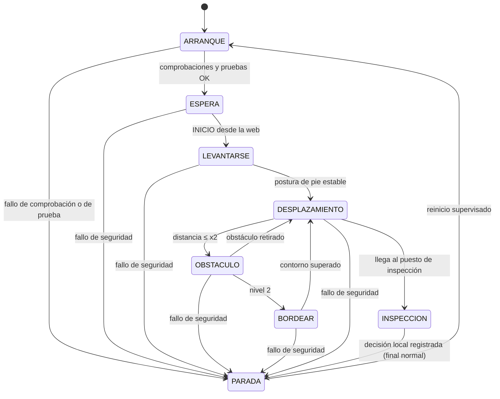

# Arquitectura y decisiones

**Entrega H1: 9 de noviembre de 2026.** Este es el documento de arquitectura y flujo del proyecto. Se actualiza durante H2–H4 y cada cambio de diseño se anota en [Decisiones fechadas](#decisiones-fechadas).

**Estados que se usan en este documento**

| Estado | Significa |
| --- | --- |
| `Especificado` | Está descrito aquí. No hay código ni ensayo. |
| `Aplicado` | Hay código en `main`, sin ensayo en el robot. |
| `Verificado en robot` | Ensayado en el robot real, con evidencia en [`pruebas.md`](pruebas.md). |

A fecha de 5 de noviembre de 2026, todo lo que contiene este documento está `Especificado`, salvo `safety.py`, que viene en la plantilla y está `Aplicado` (con pruebas sin robot; ver la sección de seguridad). Una fila solo cambia de estado con enlace a su evidencia. Los sensores que aparecen son los que lista la documentación del kit PiDog V2; ninguno figura aún como comprobado en el robot. Cada comprobación se registra en [`hardware.md`](hardware.md) y [`pruebas.md`](pruebas.md).

Cada diagrama de flujo tiene una versión vectorial en [`media/`](../media/) (SVG) que se amplía sin perder nitidez; el enlace «Ver en grande» está debajo de cada uno.

> **Alcance de esta versión.** Contiene la parte de flujo de operación, interfaces de adaptador, seguridad y máquina de estados, y los riesgos que salen de ese flujo. «Misión», «Bloques del sistema», las filas de IA local, API externa e IoT, y el plan de integración con responsables quedan como en la plantilla.

## Misión y criterio de éxito

- Plataforma y objetivo: `POR_COMPLETAR`.
- Entorno físico, punto de inicio y fin: `POR_COMPLETAR`.
- Entradas (sensores, cámara, operador) y salidas (movimiento, estado, interfaz): `POR_COMPLETAR`.
- Resultado observable que contará como éxito: `POR_COMPLETAR`.

## Bloques del sistema

## Arquitectura con componentes reales

## Flujo de operación

Hay dos recorridos: **normal** (arranque, comprobaciones, percepción, decisión, acción, registro y parada) y **de fallo** (lectura inválida, inclinación fuera de rango, obstáculo, pérdida de red o parada manual). El estado seguro final es `PARADA`: motores parados y postura estable. **Añadido respecto al boceto original, a confirmar por el equipo:** el estado `LEVANTARSE`, el máximo de N intentos en la prueba de motores, la respuesta `PARADA` ante un fallo de arranque, parar ante lectura inválida o enlace perdido, el reinicio desde `PARADA` y el nivel 2 del obstáculo (`BORDEAR`).

### Recorrido completo, de principio a fin

Es la vista general: el recorrido **normal** baja por el centro, hasta la inspección, el informe y el fin, y los de **fallo** van a `PARADA por fallo`. El detalle de cada parte está en los tres diagramas siguientes.

[Ver en grande: Recorrido completo (SVG, se puede ampliar)](../media/d0-recorrido-completo.svg)

**Dos IA y dos momentos con respecto a Internet** (según el [reto final](reto_final.md)):

- **Inspección, IA local, con Internet desconectado.** El modelo de la Raspberry Pi decide `OK` o `INCIDENCIA` sin red; el docente lo comprueba con Internet cortado, y así se demuestra que la IA es local.
- **Informe externo, con Internet restablecido.** Cuando vuelve la conexión, un segundo modelo, externo y capaz de procesar imagen y texto, recibe la imagen y un texto con la distancia y la decisión local, y devuelve un informe que se muestra en el panel. Es solo un informe: no sustituye a la decisión local y no puede mandar órdenes a los motores. Si la API falla o tarda más del tiempo máximo, el panel muestra `API_NO_DISPONIBLE` y la decisión local se mantiene.

**`INCIDENCIA` no está definida.** El enunciado y la plantilla solo dicen que el modelo local produce `OK` o `INCIDENCIA`; no precisan qué cuenta como incidencia. Depende de lo que se pida evaluar en la inspección, y el docente fijará los estímulos después del ensayo del 15 de diciembre. Hasta entonces la arquitectura solo exige que, sea cual sea el resultado, el robot termine en `PARADA`.

### 1. Arranque (ruta normal y rutas de fallo)

[Ver en grande: Arranque (SVG, se puede ampliar)](../media/d3-arranque.svg)

### 2. Ciclo de seguridad y movimiento

El ciclo se repite mientras el robot se mueve. La seguridad manda sobre el comportamiento.

[Ver en grande: Ciclo de seguridad y movimiento (SVG, se puede ampliar)](../media/d4-ciclo-seguridad.svg)

### 3. Máquina de estados

[Ver en grande: Máquina de estados (SVG, se puede ampliar)](../media/d5-estados.svg)

**Fallo de seguridad** = orden `PARADA` (web o local), enlace perdido más de 2 s, IMU fuera de rango o lectura inválida; desde cualquier estado activo lleva a `PARADA`. Es el recorrido de fallo; el final normal es `INSPECCION` → `PARADA`. **Quién reanuda:** solo la persona supervisora, con el robot en postura estable; tras una caída, el robot se recoloca a mano en HOME y se repite el arranque. El envío del informe a la API ocurre después de `INSPECCION`, con el robot ya detenido, y no mueve actuadores.

### Tabla del flujo

| Paso | Entrada y origen | Proceso o decisión | Salida y destino | Registro | Fallo y parada |
| --- | --- | --- | --- | --- | --- |
| Arranque | Batería (enchufado y %), cámara, servos (grados y conexiones), RGB, ultrasonidos, IMU y táctil (Robot HAT y Pi), con el robot en HOME. | Comprobar y recoger valores; luz RGB, % de batería y sonido; prueba de equilibrio (IMU y servos frente a sus valores de HOME) y prueba de motores. | Estado `ESPERA` y valores de referencia; RGB, % de batería y sonido por el altavoz. | Valores recogidos (inclinación, ángulos de servo, batería) con hora. | Un elemento no responde: fallo de arranque, no se mueve, aviso por consola y `PARADA`. IMU ≠ HOME y servos ≈ HOME: caído de lado o hacia arriba, `PARADA`. IMU ≠ HOME y servos ≠ HOME: causa por determinar (¿desnivel?), `PARADA`. Solo si IMU ≈ HOME y servos ≠ HOME se mueven los servos hasta S_HOME, con un máximo de N intentos, y se repite la prueba de equilibrio. |
| Percepción | Ultrasonidos (distancia en cm) e IMU (inclinación), vía Robot HAT. | Mediana de 3 lecturas, con al menos 60 ms entre lecturas (recomendación del kit); validar lecturas y enlace. | Observación para la máquina de estados. | Distancia, zona e inclinación con hora; cada cambio de zona. | Lectura ausente, inválida o ≤ 0, o enlace perdido: parar y `PARADA` (qué devuelve el sensor sin eco: ver riesgos). |
| Decisión | Observación, decisión de IA local, `INICIO` y `PARADA`, permiso de seguridad. | Lecturas válidas y enlace activo; inclinación en rango; zona segura, riesgo o peligro. | Orden limitada al adaptador y estado al panel. | Cada cambio de estado con fecha, hora y motivo. | Lectura inválida o enlace perdido: parar y `PARADA`. Inclinación fuera de rango: parar o recoger patas y `PARADA`. Distancia ≤ x2 (peligro): parar y `OBSTACULO`. |
| Acción | Orden limitada de la máquina de estados. | `move()` o `stop()` del adaptador; velocidad normal (zona segura), velocidad reducida Y (zona de riesgo) o parado (peligro). | PWM a los servos vía Robot HAT; aviso por consola y RGB naranja intermitente en riesgo; aviso por consola, RGB rojo intermitente y ladrido en peligro. | Orden enviada y resultado. | `stop()` físico; ninguna salida deja motores activos. |
| Obstáculo | Distancia ≤ x2 (zona de peligro) desde la decisión de seguridad. | Robot parado en `OBSTACULO`. Nivel 1 (mínimo del reto): espera a que se retire el obstáculo. Nivel 2 (decisión del equipo, A2): la cámara localiza el objeto, la cabeza lo apunta y el ultrasonido mide; se bordea a distancia x_b con la seguridad activa y se vuelve al rumbo (por definir). | Nivel 1: con el obstáculo retirado y la distancia mayor que x1 se vuelve a percibir y a `DESPLAZAMIENTO`. Nivel 2: contorno superado, vuelta a `DESPLAZAMIENTO`. | Entrada y salida de `OBSTACULO`, distancia, nivel y hora. | Fallo de seguridad en cualquier momento: `PARADA`. |
| Inspección | Llegada al puesto de inspección (condición por definir, A8); imagen de la cámara y distancia del ultrasonido, con el robot parado. | Modelo local en la Pi (ruta `POR_COMPLETAR`), con Internet desconectado. | `OK` o `INCIDENCIA` y estado final seguro (`PARADA`). | Imagen o referencia, distancia, decisión, latencia y hora. | Confianza baja o inferencia lenta: `POR_COMPLETAR`. |
| Informe externo | Imagen y texto con distancia y estado local, tras restablecer Internet. | Una solicitud HTTPS; el informe se valida a `observacion`, `riesgo` y `recomendacion`. | Informe mostrado en el panel; nunca llega a los actuadores. | Hora, modelo, latencia, solicitud sin secretos y respuesta. | Timeout (referencia 10 s): el panel muestra `API_NO_DISPONIBLE` y la decisión local no cambia. |
| Parada y reanudación | Orden `PARADA` (web o local), enlace perdido más de 2 s o fallo de seguridad. | `stop()` con prioridad sobre cualquier misión o llamada a la API. | Robot inmóvil en postura estable. | Motivo y hora de la parada. | Reanuda solo la persona supervisora (ver arriba). |

### Postura, marcha y estabilidad

Todo lo que sigue sale de la documentación de SunFounder (páginas de acciones predefinidas y de demostración de funciones de PiDog) y **no está comprobado en el robot**.

- **Posturas.** HOME es el robot tumbado con las patas recogidas (la acción `lie` de la librería). De pie se usa `stand`, y también existe `sit`. El robot arranca en HOME, espera, se levanta con `stand` y camina; al terminar queda detenido en postura estable.
- **Marcha.** La librería trae movimientos ya programados: `forward`, `backward`, `turn_left`, `turn_right` y `trot`. Se lanzan con `do_action(nombre, step_count, speed)`: `step_count` es cuántas veces se repite la acción (por defecto 1) y `speed` su velocidad (por defecto 50). Los giros se hacen con `turn_left` y `turn_right`, y la documentación no dice cuántos grados gira cada repetición; por eso el giro de 30–45° del reto se calibra midiendo (riesgo prioritario 2). El ejemplo oficial manda `stand` antes de caminar si la acción anterior no era de marcha, y llama a `body_stop()` antes de cada acción.
- **Qué implica para el diseño.** El avance se pide por tandas de pasos. Si una tanda no se puede interrumpir a mitad, la seguridad solo puede actuar entre órdenes, y entonces hay que pedir pocos pasos por orden, sobre todo en zona de riesgo (velocidad reducida Y). La documentación no aclara si `do_action` se interrumpe ni cuánto tarda en pararse: es una comprobación de H2 (distancia de parada, tabla de valores por medir).
- **Estabilidad.** El cuerpo se vigila con la IMU en cada ciclo. Los límites de inclinación aún no están medidos (`POR_MEDIR`). Si la inclinación sale de rango, el robot para o recoge las patas y pasa a `PARADA`. La documentación no da datos de estabilidad de la marcha: se mide en el robot, empezando con velocidad baja (riesgo prioritario 1).
- **Estado seguro final y quién reanuda.** El estado seguro es `PARADA`, con el robot inmóvil y en postura estable. Reanuda solo la persona supervisora, con el robot en postura estable. Tras una caída, el robot se recoloca a mano en HOME y se repite el arranque.

## Referencias y valores por medir

Los números del boceto (40°, 15°, 70° de inclinación) son un **ejemplo ilustrativo, no una medida**. Todo valor de esta tabla se mide en el robot real y se registra en [`pruebas.md`](pruebas.md).

| Valor | Símbolo | Estado | Cómo se mide |
| --- | --- | --- | --- |
| Inclinación del cuerpo en HOME (roll y pitch) | IMU_HOME | `POR_MEDIR` (el boceto espera ≈ 0°) | Robot en HOME sobre suelo plano, promedio de varias lecturas. |
| Ángulos de servo en HOME | S_HOME | `POR_MEDIR` | Tras la calibración de [`hardware.md`](hardware.md). |
| Inclinación y ángulos de servo de pie | IMU_PIE, S_PIE | `POR_MEDIR` | Igual que en HOME, tras `LEVANTARSE`. |
| Tolerancia respecto a HOME | | `POR_MEDIR` | Variación entre arranques repetidos. |
| Límite de inclinación al caminar y tiempo que debe mantenerse | | `POR_MEDIR` | Caminar y anotar el máximo normal; el límite queda por encima de él y por debajo de una caída. |
| Distancia de riesgo | x1 | `POR_MEDIR` | Según velocidad y distancia de frenado. |
| Distancia de peligro | x2 | `POR_MEDIR` | `minimum_obstacle_cm` de la configuración (25 en la plantilla, sin medir). |
| Distancia al bordear, tolerancia y tiempo máximo (nivel 2) | x_b | `POR_MEDIR` | Ensayo con cajas de caras rectas y de caras giradas. |
| Distancia de parada del robot | | `POR_MEDIR` | Ensayo supervisado; se anota en [`hardware.md`](hardware.md). |
| Velocidad en zona de riesgo | Y | `POR_MEDIR` | Velocidad reducida a la que el robot aún frena a tiempo antes de x2; se mide junto con x1 y x2. |
| Reintentos N de la prueba de motores y batería mínima | | `POR_DEFINIR` | Decisión del equipo. |

## Interfaces

| Componente | Entrada | Salida | Medio | Error y respuesta segura |
| --- | --- | --- | --- | --- |
| Adaptador de robot (`pidog.py`) | `move(command)` y `stop()` de la máquina de estados; lecturas del Robot HAT. | `read_observation()`: distancia (cm), inclinación (°), batería, estado de servos; PWM a los servos. | Llamadas Python a las librerías de SunFounder. Solo está documentada `Pidog.ultrasonic.read_distance()` (cm); el resto de nombres se confirman en el código de la librería. | Sensor sin respuesta o valor inválido: devuelve `None`; la máquina de estados lo trata como lectura inválida: parar y `PARADA`. |
| Seguridad (`safety.py`) | `emergency_stop`, `network_connected`, `obstacle_cm`, `minimum_obstacle_cm`. | Permite o deniega el movimiento. | Función Python en la misma Pi. | Deniega con parada de emergencia, enlace perdido, distancia `None` o ≤ 0, o distancia ≤ mínimo. |
| Máquina de estados | Observaciones, decisión de IA local, `INICIO`, `PARADA`, permiso de seguridad. | Orden limitada al adaptador; estado y registro al panel. | Llamadas Python en la Pi, sin red. | Dato ausente o estado desconocido: `PARADA`. |
| IA local | | | | |
| API externa multimodal | Imagen + consulta textual con medida | Informe, sin órdenes motoras | | Timeout → decisión local intacta |
| IoT | | | | |

## Seguridad, riesgos y plan de integración

**Respuesta ante cada evento**

| Evento | Cómo se detecta | Respuesta | Estado final |
| --- | --- | --- | --- |
| Obstáculo en zona de riesgo | Distancia entre x2 y x1 | Aviso por consola, RGB naranja intermitente, reduce la velocidad a Y | `DESPLAZAMIENTO`, más lento |
| Obstáculo en zona de peligro | Distancia ≤ x2 | Aviso por consola, RGB rojo intermitente, parar y ladrar | `OBSTACULO`, parado |
| Obstáculo retirado (nivel 1) | Distancia mayor que x1 tras `OBSTACULO` | Volver a percibir y reanudar la marcha | `DESPLAZAMIENTO` |
| Obstáculo con nivel 2 (decisión del equipo) | Decisión del equipo tras `OBSTACULO` | Bordear a distancia x_b con la seguridad activa; volver al rumbo (por definir) | `BORDEAR`, luego `DESPLAZAMIENTO` |
| Caída o inclinación | IMU fuera de rango | Parar o recoger patas | `PARADA` |
| Lectura inválida | Sin dato o ≤ 0 | Parar | `PARADA` |
| Pérdida de comunicación | Sin latido del panel durante `network_timeout_s` (≤ 2 s en el reto) | Parar | `PARADA` |
| Parada manual | `PARADA` desde la web, o parada local | `stop()` con prioridad | `PARADA` |

- **Límites de movimiento y condición de parada local:** los valores están en la tabla de referencias. Acción física local para detener el robot (interruptor, comando en terminal u otra): `POR_COMPLETAR`; el docente la comprueba en el reto.
- **Qué cubre ya `safety.py`:** la función de la plantilla cubre parada, enlace perdido y lectura inválida o demasiado cercana. Se ejecutó el 5 de noviembre de 2026 fuera del robot: las 2 pruebas de la plantilla pasan; con `minimum_obstacle_cm=25`, 100 cm y 26 cm permiten el movimiento, y 25 cm, 0 cm y `None` lo deniegan. **No cubre** la inclinación de la IMU ni la zona de riesgo con velocidad reducida: son trabajo de H2 y necesitan pruebas con mitad negativa (que el movimiento se permita sin el riesgo y se deniegue con él).
- **Riesgo prioritario 1: marcha inestable y umbrales de inclinación sin medir.** Una caída o una parada falsa depende de números que aún no existen. Alternativa: empezar con una marcha lenta y un límite conservador, ensayar sobre suelo despejado y delimitado, y subir la velocidad solo con datos medidos.
- **Riesgo prioritario 2: giro de 30–45° sin referencia de orientación absoluta.** La IMU de la documentación no incluye magnetómetro, así que el giro sobre sí mismo (yaw) se obtiene integrando el giroscopio y se desvía con el tiempo. Alternativa: girar por pasos de marcha calibrados, comprobar el ángulo con una marca en el suelo y medir el error de varios giros.
- **Otros riesgos:** el ultrasonido puede no detectar objetos pequeños o de superficie blanda (la documentación pide objetos planos y de al menos 0,5 m²), así que se prueba con el bloque real; no está confirmado qué devuelve `read_distance()` sin eco, y hay que distinguir «nada delante» de «fallo» para no parar sin motivo; la latencia de la visión del obstáculo (nivel 2) se mide en el robot.
- **Plan de integración por hito, responsables, y dónde se hace la inferencia local, qué datos van a la API y cómo se evita que su respuesta mueva actuadores:** `POR_COMPLETAR`.

**Decisiones abiertas y dependencias**

| ID | Pregunta | Cómo se resuelve |
| --- | --- | --- |
| A1 | ¿Qué valor muestra `0_calibration.py` para cada servo (desplazamiento de calibración o ángulo real) y existe lectura real del ángulo? De ello depende la prueba de equilibrio. | Leer el código de la librería y probar en el robot. |
| A2 | Obstáculo: el mínimo del reto (nivel 1) es detenerse y reanudar cuando se retire. ¿Se añade el nivel 2: la cámara localiza el objeto, la cabeza lo apunta, el ultrasonido mide y el robot bordea a distancia x_b? | Decisión del equipo; depende de los puntos de A6. |
| A3 | Respuesta exacta a un fallo de comprobación en el arranque y número de reintentos. | Decisión del equipo (propuesta: `PARADA`). |
| A4 | Acción local de parada física. | Decisión y ensayo en H2. |
| A6 | Nivel 2: ¿la cámara ve el suelo y detecta objetos que no están entre las clases de su modelo? Con un solo ultrasonido, la cabeza alterna frente y lado y la tasa de lectura es baja. Las caras inclinadas (un rombo) pueden desviar el sonido. Hacen falta reglas para las esquinas y para volver al rumbo. | Foto desde el robot; ensayo con cajas de caras rectas y giradas; medir latencia y tasa de lectura. |
| A7 | Qué es una `INCIDENCIA`. No está definida en el enunciado ni en la plantilla; depende de lo que se evalúe en la inspección. | El docente fija los estímulos tras el ensayo del 15 de diciembre; se definirá en [`ia.md`](ia.md). |
| A8 | Qué es el puesto de inspección y cómo detecta el robot que ha llegado. No está definido en el enunciado ni en la plantilla. | Preguntar al docente; el docente fija las medidas de la pista tras el ensayo del 15 de diciembre. |

**Dependencias:** librerías de SunFounder (`robot-hat`, `vilib`, `pidog`, según la FAQ del kit) con la versión exacta anotada en [`instalacion.md`](instalacion.md).

La decisión A5 (ruta de IA local, modelo externo, protocolo IoT, revisión del Robot HAT y roles) la gestiona el resto del equipo.

## Decisiones fechadas

| Fecha | Decisión | Alternativas consideradas | Evidencia / motivo | Issue o PR |
| --- | --- | --- | --- | --- |
| 2026-11-03 | Arrancar en HOME con las patas recogidas y comparar IMU y servos con las referencias de HOME antes de levantarse. | Arrancar de pie; comparar solo la IMU. | La IMU mide la inclinación del cuerpo. La postura de las patas se conoce por los ángulos ordenados a los servos y, si la librería permite leerlos, por los ángulos leídos (decisión abierta A1). | `POR_COMPLETAR` |
| 2026-11-03 | Sensor frontal: ultrasonidos de la cabeza, sin lidar. | Lidar 2D; sensor adicional apuntando al suelo. | El kit lo incluye (HC-SR04 según la documentación de SunFounder, 2–400 cm); basta para parar ante un obstáculo. El lidar añade coste, peso, consumo y software.  | `POR_COMPLETAR` |
| 2026-11-03 | La seguridad se evalúa en cada ciclo, por encima del comportamiento, con tres zonas (segura, riesgo, peligro) y mediana de 3 lecturas. | Una sola distancia de parada; decidir solo al parar. | Permite frenar antes de parar; la mediana reduce lecturas aisladas; el kit recomienda al menos 60 ms entre lecturas. | `POR_COMPLETAR` |
| 2026-11-03 | La lógica se separa en tres bloques: seguridad (en paralelo), andar y obstáculo. | Un solo bloque. | Separa la reacción rápida de la decisión lenta; la seguridad sigue activa mientras se bordea o se pasa un obstáculo. | `POR_COMPLETAR` |

## Fuentes consultadas

- [SunFounder PiDog: documentación](https://docs.sunfounder.com/projects/pidog/en/latest/)
- [6-DOF IMU](https://docs.sunfounder.com/projects/pidog/en/latest/hardware/cpn_6dof_imu.html)
- [Módulo de ultrasonidos](https://docs.sunfounder.com/projects/pidog/en/latest/_shared/component/cpn_ultrasonic_module.html)
- [Read Distance](https://docs.sunfounder.com/projects/pidog/en/latest/python/py_b8_read_distance.html)
- [Calibrating PiDog](https://docs.sunfounder.com/projects/pidog/en/latest/python/py_0_calibrate.html)
- [FAQ](https://docs.sunfounder.com/projects/pidog/en/latest/faq.html)
- [Acciones predefinidas (`do_action`), versión japonesa de la página](https://docs.sunfounder.com/projects/pidog/ja/latest/python/py_b6_preset_action.html)
- [Demostración de funciones, versión francesa de la página](https://docs.sunfounder.com/projects/pidog/fr/latest/python/py_2_function_demonstration.html)
